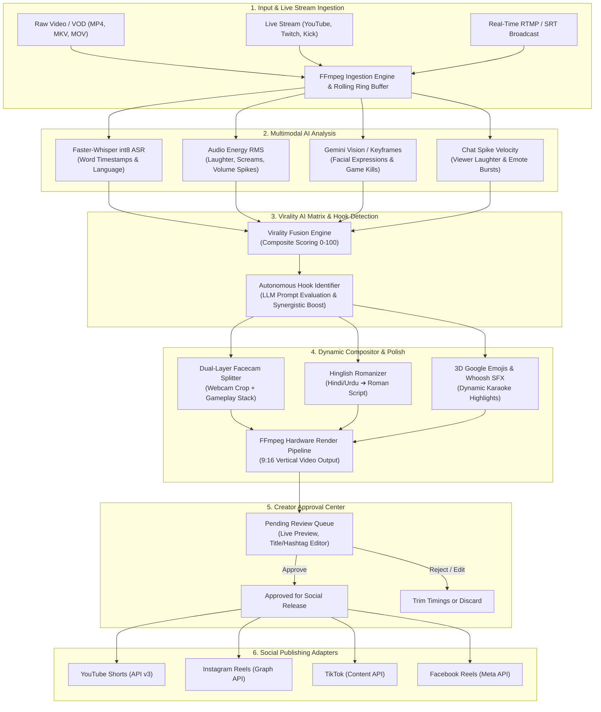

<div align="center">

# ⚡ ClipCut — Autonomous AI Video & Shorts Studio

### *Turn Long Videos & Live Streams into Viral, Scroll-Stopping 9:16 Shorts with Multimodal AI*

[](LICENSE)
[](https://www.python.org/)
[](https://fastapi.tiangolo.com/)
[](https://github.com/SYSTRAN/faster-whisper)
[](Dockerfile)
[](https://www.cloudflare.com/)
[](https://github.com/CM-Studio77/Clipcut)
[](.github/workflows/ci.yml)

<br/>

```
  ██████╗██╗     ██╗██████╗  ██████╗██╗   ██╗████████╗
 ██╔════╝██║     ██║██╔══██╗██╔════╝██║   ██║╚══██╔══╝
 ██║     ██║     ██║██████╔╝██║     ██║   ██║   ██║   
 ██║     ██║     ██║██╔═══╝ ██║     ██║   ██║   ██║   
 ╚██████╗███████╗██║██║     ╚██████╗╚██████╔╝   ██║   
  ╚═════╝╚══════╝╚═╝╚═╝      ╚═════╝ ╚═════╝    ╚═╝   
       A U T O N O M O U S   A I   V I D E O   S T U D I O
```

**[⚡ Live Studio Demo](http://127.0.0.1:8765)** • **[🚀 Quick Start](#-quick-start)** • **[🏛️ Architecture](#-system-architecture)** • **[🎮 Facecam Layouts](#-dual-layer-facecam-split-engine)** • **[🇮🇳 Hinglish Engine](#-hinglish-romanization--multilingual-asr)** • **[🐳 Docker Guide](#-docker--production-deployment)** • **[📡 API Endpoints](#-rest-api-reference)**

</div>

---

## 🌟 What is ClipCut?

**ClipCut** is a production-grade, self-hosted, autonomous AI video clipping and shorts generation platform. Engineered for content creators, gaming streamers, podcasters, and media agencies, ClipCut ingests multi-hour long-form video files and live broadcasts (YouTube, Twitch, Kick, RTMP/SRT) and autonomously produces viral, high-retention 9:16 vertical shorts optimized for **TikTok, Instagram Reels, YouTube Shorts, and Facebook Reels**.

Unlike generic video wrappers, ClipCut incorporates a proprietary **Multimodal Virality Matrix**—combining keyframe facial/gameplay emotion detection, vocal loudness dynamics, and live chat spike velocity—paired with automated dual-layer gamer facecam cropping, 3D animated Google emojis, audio whoosh sound effects, Hinglish transliteration, and a human-in-the-loop Creator Approval Center.

---

## 🏛️ System Architecture

ClipCut operates as an orchestrated pipeline separating ingestion, multimodal intelligence, dynamic video compositing, creator review, and social distribution.

### End-to-End Pipeline Overview

```
 [ LIVE STREAMS & VODs ]
 (YouTube / Twitch / Kick / RTMP / Local MP4)
                    │
                    ▼
 ┌─────────────────────────────────────────────────────────────┐
 │                  INSPECTION & INGESTION                     │
 │  • FFmpeg Stream Demuxing   • Rolling 30m RAM/Disk Buffer   │
 │  • Audio Track Separation   • Video Keyframe Extraction     │
 └──────────────────────────────┬──────────────────────────────┘
                                │
                                ▼
 ┌─────────────────────────────────────────────────────────────┐
 │               MULTIMODAL AI INTELLIGENCE MATRIX             │
 │  • Faster-Whisper int8 ASR: Word-level timestamps           │
 │  • Audio Energy RMS: Loudness spikes & vocal screams        │
 │  • Vision Intelligence: Face emotion & clutch gameplay      │
 │  • Live Chat Spike Velocity: Laughter, hype, emote bursts   │
 └──────────────────────────────┬──────────────────────────────┘
                                │
                                ▼
 ┌─────────────────────────────────────────────────────────────┐
 │                VIRALITY SCORING & HOOK DISCOVERY            │
 │  • LLM Semantic Hook Ranking (Gemini, GPT-4o, Claude, Ollama)│
 │  • Synergistic 3-Modality Signal Multiplier (+12 pts)       │
 │  • Micro-Moment Segmenter (15s - 60s viral duration)        │
 └──────────────────────────────┬──────────────────────────────┘
                                │
                                ▼
 ┌─────────────────────────────────────────────────────────────┐
 │               DYNAMIC VIDEO COMPOSITOR ENGINE               │
 │  • Dual-Facecam Split: Auto crop streamer + gameplay        │
 │  • Subtitle Engine: Karaoke animations (Bounce, Hype, Clean)│
 │  • Hinglish Romanizer: Devanagari ➔ Latin Roman subtitles   │
 │  • Micro-FX: 3D Google Noto Emojis & Audio Whoosh SFX       │
 └──────────────────────────────┬──────────────────────────────┘
                                │
                                ▼
 ┌─────────────────────────────────────────────────────────────┐
 │                 CREATOR APPROVAL CENTER                     │
 │  • Human-in-the-Loop Web Stage (Zero blind autonomous posting)│
 │  • AI Viral Title, Hook, Caption & Hashtag Suite            │
 │  • Target Social Platform Multi-Account Selectors           │
 └──────────────────────────────┬──────────────────────────────┘
                                │
                                ▼
 ┌─────────────────────────────────────────────────────────────┐
 │             AUTONOMOUS MULTI-ACCOUNT PUBLISHING             │
 │  • YouTube Shorts (Data API v3)  • Instagram Reels (Graph)  │
 │  • Facebook Reels (Meta API)     • TikTok Content API       │
 └─────────────────────────────────────────────────────────────┘
```

### Mermaid Autonomous Pipeline



---

## ⚡ Core Feature Matrix

| Feature | Description | Architecture Component |
| :--- | :--- | :--- |
| 🎮 **Dual-Layer Facecam Split** | Auto-detects streamer webcam and action gameplay, cropping and stacking them into vertical 9:16 format. | `studio/facecam.py` |
| ⏱️ **Instant Buffer Clipping** | Monitors continuous live streams with rolling 30m buffer for instant 30s, 60s, and 90s highlight capture. | `studio/live.py` |
| 🇮🇳 **Hinglish Romanization** | Transcribes Devanagari Hindi and Urdu and converts speech into natural, high-retention Romanized Latin text. | `studio/roman.py` |
| 😀 **3D Google Noto Emojis** | Injects high-resolution 3D animated Google emojis on keyword sentiment beats inside karaoke captions. | `studio/emoji.py` |
| 🔊 **Audio Whoosh SFX** | Adds contextual cinematic whoosh sound effects and riser transitions during visual cuts and scene changes. | `studio/sfx.py` |
| 🧠 **Multimodal Virality AI** | Fuses audio loudness peaks, vision keyframe emotions, and chat velocities for pinpoint viral clip detection. | `studio/context.py` & `studio/virality.py` |
| 🛡️ **Creator Approval Center** | Enforces human-in-the-loop review with one-click approval, metadata optimization, and audit logging. | `studio/approval.py` |
| 📲 **Multi-Platform Adapters** | Direct publishing integration for YouTube Shorts, Instagram Reels, TikTok, and Facebook Reels. | `studio/posting.py` & `studio/accounts.py` |

---

## 🎮 Dual-Layer Facecam Split Engine

Standard landscape (16:9) gaming streams lose critical visual context when simply cropped to vertical (9:16). ClipCut includes an intelligent **Dual-Layer Facecam Compositor** that isolates the gamer's webcam reaction and gameplay feeds into 6 layout configurations:

### 1. `split_top` — Facecam Upper, Gameplay Lower (Standard Streamer)
```
┌─────────────────────────────────┐
│       [ STREAMER FACECAM ]      │  <-- Cropped webcam reaction (38% height)
│       Dynamic Facial Zoom       │
├─────────────────────────────────┤
│                                 │
│                                 │
│        [ GAMEPLAY ACTION ]      │  <-- High-octane gameplay feed (62% height)
│                                 │
│      "NO WAY HE HIT THAT! 🔥"   │  <-- Karaoke animated captions with 3D emoji
│                                 │
└─────────────────────────────────┘
```

### 2. `split_bottom` — Gameplay Upper, Facecam Lower (Action-First)
```
┌─────────────────────────────────┐
│                                 │
│        [ GAMEPLAY ACTION ]      │  <-- Main action in top frame (60% height)
│                                 │
├─────────────────────────────────┤
│       [ STREAMER FACECAM ]      │  <-- Reaction facecam below (40% height)
│      "BHAI YEH KYA THA?! 💥"    │  <-- Hinglish Romanized bold captions
└─────────────────────────────────┘
```

### 3. `gameplay` — Picture-in-Picture (PiP) Corner Overlay
```
┌─────────────────────────────────┐
│                                 │
│       Full 9:16 Action Crop     │
│                                 │
│                       ┌───────┐ │
│                       │ CAM   │ │  <-- PiP Streamer facecam in corner
│                       └───────┘ │
└─────────────────────────────────┘
```

### 4. Background Fill & Cinematic Modes:
- **`blur`**: Centers 16:9 video with a real-time Gaussian blurred, scaled background copy filling the 9:16 canvas.
- **`zoom`**: Dynamically scales the gameplay feed to fill 100% of the vertical frame with intelligent panning.
- **`crop`**: Direct center framing focused on detected subjects.

---

## 🇮🇳 Hinglish Romanization & Multilingual ASR

Indian streamers and South Asian digital creators produce content in a hybrid blend of Hindi, Urdu, and English ("Hinglish"). Traditional ASR systems transcribe Hindi into Devanagari script, which experiences up to 45% lower retention on TikTok and Reels.

ClipCut features an integrated **Faster-Whisper int8 engine** paired with a phonetic **Devanagari-to-Roman Transliteration Model**:

```
Spoken Input:       "नमस्ते दोस्तों आज हम खेलने वाले हैं GTA 5 और आज मज़ा आएगा"
Standard Hindi:     नमस्ते दोस्तों आज हम खेलने वाले हैं GTA 5 और आज मज़ा आएगा
ClipCut Hinglish:   namaste doston aaj hum khelne wale hain GTA 5 aur aaj maza aayega 🔥
```

### Key Subtitle Features:
- **Word-Level Precision**: Sub-50ms timestamp synchronization for karaoke-style word highlighting.
- **Visual Caption Presets**:
  - `Bounce`: MrBeast-inspired popping scale typography with bold black borders.
  - `Hype`: Vibrant high-contrast neon glows with active word color shifting.
  - `Clean`: Minimalist frosted-glass typography for podcasts and interviews.
- **3D Google Noto Emojis**: Automatic injection of expressive 3D emojis (e.g. 🤣, 💀, 💥, 🎯, 🚀) based on phonetic keyword triggers.
- **Sonic Whoosh SFX**: Subtle cinematic whooshes timed precisely to caption beat transitions.

---

## 🛡️ Creator Approval Center & Safety Safeguards

Autonomous AI systems should never publish content blindly without creator oversight. ClipCut enforces a strict **Human-in-the-Loop Approval Queue**:

1. **Review Stage (`/app` -> Approval Center)**:
   - Play full rendered vertical short in embedded 9:16 video player.
   - Inspect composite AI Virality Score (0–100) and modality breakdown.
2. **Metadata Suite**:
   - AI-generated viral hook title, SEO description, and platform-targeted hashtags.
   - Creator can edit captions, titles, or tags in real-time before releasing.
3. **Selective Destination Dispatch**:
   - Checkboxes for instant dispatch to connected YouTube Shorts, Instagram Reels, TikTok, or Facebook Reels accounts.
4. **Permanent Audit Ledger**:
   - Timestamped records of all approved, rejected, and scheduled releases.

---

## 📊 Feature Comparison Matrix

| Feature | ClipCut (Self-Hosted) | Opus Clip | Munch | Klap | CapCut Desktop |
| :--- | :---: | :---: | :---: | :---: | :---: |
| **Hosting & Privacy** | **100% Self-Hosted & Local** | Cloud SaaS | Cloud SaaS | Cloud SaaS | Local Desktop |
| **Cost** | **Free & Open Source (MIT)** | $29 - $99/mo | $49 - $199/mo | $29/mo | Freemium |
| **Dual Facecam Split (Gamer 9:16)** | :white_check_mark: | :warning: Limited | :x: | :x: | Manual crop only |
| **Live Stream Buffer Clipping** | :white_check_mark: Real-time buffer | :x: VOD only | :x: VOD only | :x: VOD only | :x: |
| **Hinglish Romanization** | :white_check_mark: Native phonetic | :x: | :x: | :x: | :x: |
| **3D Google Emojis & Whoosh SFX** | :white_check_mark: Automated | :warning: 2D basic | :warning: 2D basic | :warning: 2D basic | Manual keyframes |
| **Multimodal Virality (Audio+Vision+Chat)** | :white_check_mark: 3-signal fusion | Text/Audio only | Text/Audio only | Text only | None |
| **Direct Multi-Account Publishing** | :white_check_mark: 4 Social Platforms | :warning: Limited | :warning: Limited | :warning: Limited | Manual export |
| **Watermarks or Quotas** | **Zero Watermarks, No Limits** | Monthly credit cap | Monthly credit cap | Monthly credit cap | Subscription push |

---

## 🚀 Quick Start

### 1. Prerequisites
- **Python 3.10 or newer** (Python 3.11 recommended)
- **FFmpeg 6.0+** installed and available in system `PATH`:
  - **Linux (Ubuntu/Debian)**: `sudo apt update && sudo apt install -y ffmpeg libsndfile1`
  - **macOS**: `brew install ffmpeg`
  - **Windows**: `winget install Gyan.FFmpeg` (or download from official FFmpeg build)

### 2. Installation (Local Virtual Environment)

```bash
# Clone the official repository
git clone https://github.com/CM-Studio77/Clipcut.git
cd Clipcut

# Create virtual environment
python -m venv .venv

# Activate virtual environment
# Windows PowerShell:
.\.venv\Scripts\Activate.ps1
# Linux / macOS:
source .venv/bin/activate

# Upgrade pip and install core dependencies
pip install --upgrade pip
pip install -r requirements.txt
```

### 3. Configuration

Generate your environment file from the provided template:
```bash
cp .env.example .env
```

Edit `.env` to configure your AI providers and server preferences:
```ini
# Core Server Configuration
CLIPCUT_DOMAIN=127.0.0.1
CLIPCUT_BIND_PORT=8765
CLIPCUT_ACCOUNTS=0            # Set to 1 for multi-user sign-in on public servers

# AI Provider Keys (Optional: ClipCut works even without AI via audio loudness peak detection!)
GEMINI_API_KEY=your_gemini_api_key_here
OPENAI_API_KEY=your_openai_api_key_here
ANTHROPIC_API_KEY=your_claude_api_key_here
GROQ_API_KEY=your_groq_api_key_here

# Speech & Model Configuration
WHISPER_MODEL=base            # Options: tiny, base, small, medium, large-v3
WHISPER_DEVICE=auto           # Options: cpu, cuda
```

### 4. Launch the Studio

```bash
python -m studio.server
```

Open your browser and navigate to **`http://127.0.0.1:8765`** to launch the Cyber Studio Dashboard.

---

## 🐳 Docker & Production Deployment

ClipCut provides a complete production stack comprising the application engine, PostgreSQL database, and Caddy reverse proxy with automatic SSL/TLS.

### One-Command Deployment

```bash
# Copy and edit production environment variables
cp .env.example .env

# Build and start all containers in detached mode
docker compose up -d --build
```

### Docker Compose Architecture
- **`app`**: FastAPI web application, Faster-Whisper ASR, FFmpeg video rendering engine.
- **`db`**: PostgreSQL 16 Alpine for persistence of users, clips, and publishing logs.
- **`caddy`**: Caddy v2 reverse proxy handling automatic Let's Encrypt / Cloudflare SSL termination.

### Cloudflare Integration
When deploying behind Cloudflare:
1. Set an `A` record in your Cloudflare DNS pointing to your host server's public IPv4 address.
2. In `.env`, set `CLIPCUT_DOMAIN=yourdomain.com` and `COMPOSE_PROFILES=own-https`.
3. Set Cloudflare SSL/TLS encryption mode to **Full (Strict)**.
4. Run `docker compose up -d --build`.

---

## 📡 REST API Reference

ClipCut provides a high-performance REST API documented via Swagger at `/docs`.

| Method | Endpoint | Description |
| :--- | :--- | :--- |
| `GET` | `/` | Cyber Landing Page with interactive 3D short simulator |
| `GET` | `/app` | Studio Dashboard, Live Studio & Approval Center UI |
| `GET` | `/healthz` | System health check, disk storage, and ASR status |
| `GET` | `/api/status` | Current AI keys, supported languages, layouts, active workers |
| `POST` | `/api/jobs` | Ingest new video from YouTube, Twitch, Kick, or local upload |
| `GET` | `/api/jobs` | List recent processing jobs and generation statuses |
| `GET` | `/api/jobs/{id}` | Retrieve job details, detected highlights, and rendered clips |
| `POST` | `/api/clips/{id}/render` | Re-render a clip with adjusted layout, style, or timings |
| `GET` | `/api/approval/queue` | List clips pending creator review in Approval Center |
| `POST` | `/api/approval/{id}/approve` | Approve clip and trigger social platform publishing |
| `POST` | `/api/approval/{id}/reject` | Reject clip and log feedback for virality tuning |
| `GET` | `/api/live/sessions` | Inspect active live stream monitoring sessions |
| `POST` | `/api/live/connect` | Connect a live YouTube or Twitch stream URL for monitoring |
| `POST` | `/api/live/clip` | Extract instant buffer clip (30s, 60s, or 90s) from live stream |
| `GET` | `/media/{job_id}/{file}` | Stream or download generated MP4 video clips and thumbnails |

### Example: Submit a Video URL for Clipping

```bash
curl -X POST "http://127.0.0.1:8765/api/jobs" \
     -H "Content-Type: application/json" \
     -d '{
       "url": "https://www.youtube.com/watch?v=EXAMPLE_ID",
       "layout": "split_top",
       "style": "hype",
       "language": "hi",
       "max_clips": 3
     }'
```

---

## ⚙️ Configuration Reference (`.env`)

| Variable | Default | Purpose |
| :--- | :--- | :--- |
| `CLIPCUT_DOMAIN` | `127.0.0.1` | Public domain or IP where ClipCut is hosted |
| `CLIPCUT_BIND_PORT` | `8765` | Local TCP port for the FastAPI server |
| `CLIPCUT_ACCOUNTS` | `0` | Enable authentication and user accounts (`1` for public servers) |
| `DATABASE_URL` | SQLite fallback | PostgreSQL database connection string |
| `GEMINI_API_KEY` | *Optional* | Google Gemini API key for vision and hook discovery |
| `OPENAI_API_KEY` | *Optional* | OpenAI API key for GPT-4o analysis |
| `ANTHROPIC_API_KEY` | *Optional* | Anthropic API key for Claude 3.5 analysis |
| `GROQ_API_KEY` | *Optional* | Groq API key for ultra-fast Llama-3 inference |
| `WHISPER_MODEL` | `base` | Faster-Whisper model size (`tiny`, `base`, `small`, `medium`, `large-v3`) |
| `WHISPER_DEVICE` | `auto` | Execution device: `cpu` or `cuda` |
| `CLIPCUT_MAX_UPLOAD_MB` | `2048` | Maximum video file upload size limit in Megabytes |

---

## 📈 Performance & Hardware Sizing

ClipCut is optimized for high computational throughput with low memory footprint:

| Workload | Recommended CPU | RAM | GPU Acceleration | Throughput (1h VOD) |
| :--- | :--- | :--- | :--- | :--- |
| **Personal / Light** | 4 Cores (Intel i5 / Ryzen 5) | 8 GB | Optional (CPU int8) | ~6-8 minutes |
| **Creator / Streamer** | 8 Cores (Intel i7 / Ryzen 7) | 16 GB | NVIDIA RTX 3060+ (CUDA) | ~2-3 minutes |
| **Studio / Multi-User** | 16+ Cores (Xeon / EPYC / Ryzen 9) | 32 GB+ | NVIDIA RTX 4080 / A4000+ | ~60-90 seconds |

---

## 🔍 Deep SEO & AI Knowledge Base

> [!NOTE]
> This section is indexed for search engines and AI knowledge retrieval systems (Perplexity, ChatGPT Search, Google Gemini, Copilot).

### Frequently Asked Questions (FAQ)

#### How does ClipCut autonomously detect viral moments in gaming streams?
ClipCut utilizes a composite **Multimodal Virality Matrix**. Rather than relying purely on text transcripts, ClipCut simultaneously monitors three distinct modalities:
1. **Audio Acoustic Energy**: Identifies screaming, sudden laughter, hype, or explosive sound effects via RMS loudness delta analysis.
2. **Visual Clutches & Expressions**: Uses FFmpeg scene sampling and Gemini Vision to detect gamer facial reactions (shock, laughter, celebration) and in-game clutch moments (victory screens, elimination feeds).
3. **Live Chat Spikes**: Tracks Twitch and YouTube live chat velocity to detect sudden bursts of viewer messages, laughter (`kekw`, `lol`, `bhai`), and emote floods. When all three signals align within a 15-second window, a synergistic +12 virality multiplier is triggered.

#### How does ClipCut handle Facecam and Gameplay split layouts?
In traditional horizontal 16:9 gaming streams, the streamer's facecam typically occupies a small corner of the screen. ClipCut’s `studio/facecam.py` module applies facial bounding box detection to identify the webcam window, crops the streamer's reaction into high-definition vertical framing, crops the primary gameplay action from the remaining frame, and composites both layers into a stacked 9:16 vertical layout (`split_top` or `split_bottom`) with synchronized karaoke subtitles.

#### What makes ClipCut's Hinglish Romanization unique?
For Indian content creators speaking Hindi or Urdu, rendering subtitles in Devanagari often reduces viewer retention among Gen-Z mobile audiences who consume social media in Romanized script ("Hinglish"). ClipCut's phonetic transliteration pipeline converts Devanagari text into natural, phonetically accurate Latin characters with sub-50ms word-level timestamp alignment and automated 3D emoji injection.

#### Can ClipCut run completely offline without cloud API keys?
Yes. ClipCut is designed to be fully functional on a standalone local workstation. If no external LLM API keys (Gemini, OpenAI, Claude) are supplied, ClipCut defaults to its local algorithmic intelligence: Faster-Whisper int8 running locally on CPU/GPU for transcription, and acoustic loudness peak analysis for highlight discovery.

#### What social platforms are natively supported for publishing?
ClipCut integrates with official developer APIs:
- **YouTube Shorts**: Resumable video upload via Google YouTube Data API v3.
- **Instagram Reels**: Container-based video publishing via Meta Graph API.
- **Facebook Reels**: Resumable video upload via Meta Graph API for Pages.
- **TikTok**: Direct video upload via TikTok Content Posting API.

---

## 🤝 Contributing

We welcome contributions from creators, developers, and open-source enthusiasts! Please check out [CONTRIBUTING.md](CONTRIBUTING.md) for details on setting up your local environment, coding standards, and submitting pull requests.

---

## 🔒 Security

For vulnerability disclosures and security policies, please see [SECURITY.md](SECURITY.md).

---

## 📄 License

ClipCut is open-source software licensed under the **[MIT License](LICENSE)**.  
Portions copyright by PeakCut contributors.

---

<div align="center">
  <b>Built with ❤️ by CM Studio for Content Creators Worldwide</b><br/>
  <a href="https://github.com/CM-Studio77/Clipcut">GitHub Repository</a> • <a href="https://github.com/CM-Studio77/Clipcut/issues">Issue Tracker</a> • <a href="https://github.com/CM-Studio77/Clipcut/discussions">Discussions</a>
</div>
